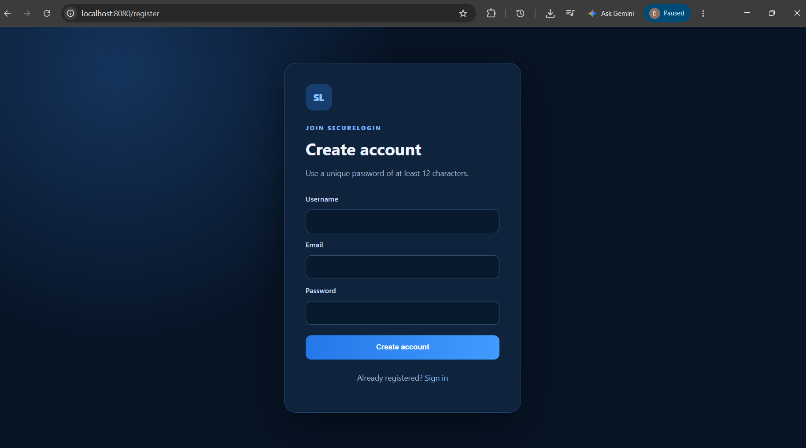
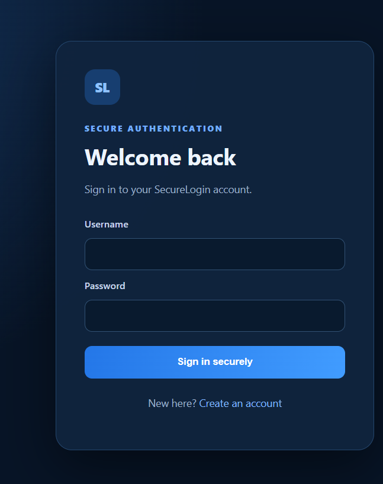
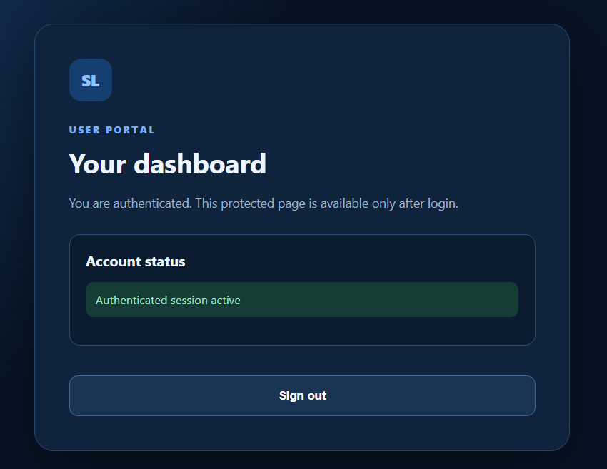

# SecureLogin

A Java + Spring Boot + MySQL secure authentication project.

## Current implementation (V1 foundation)
- User registration with server-side validation
- BCrypt password hashing (cost factor 12)
- MySQL persistence through Spring Data JPA
- Spring Security form login and logout
- Protected dashboard
- Role-aware authorization foundation (`USER`, `ADMIN`)
- CSRF protection enabled
- Session fixation protection and HTTP-only session cookie

## Requirements
- JDK 26
- MySQL Server
- VS Code with Java support (or another Java IDE)

## 1. Create the database
Run in MySQL:

```sql
CREATE DATABASE securelogin_db;
```

## 2. Configure database credentials
The default username is `root`. Set your password as an environment variable in PowerShell:

```powershell
$env:DB_USERNAME="root"
$env:DB_PASSWORD="your_actual_mysql_password"
```

Do not commit real database passwords to GitHub. Change the placeholder in `application.properties` only for local experimentation; environment variables are preferred.

## 3. Run
From the project root in PowerShell:

```powershell
mvn spring-boot:run
```

Open http://localhost:8080/register, create an account, then sign in at http://localhost:8080/login.

## Notes
- The first registered account receives the `USER` role. Do not expose admin-role assignment to public registration.
- V2 (TOTP MFA, password reset workflow, login history, risk signals and throttling) and V3 (admin UI, audit-event views and analytics) are planned extensions, not implemented in this starter.
- Before deployment, use HTTPS, secure cookie settings, secret management, database migrations, generic account-recovery responses, rate limiting, monitoring, and security testing.
## Screenshots

### Registration Page


### Login Page


### Dashboard

